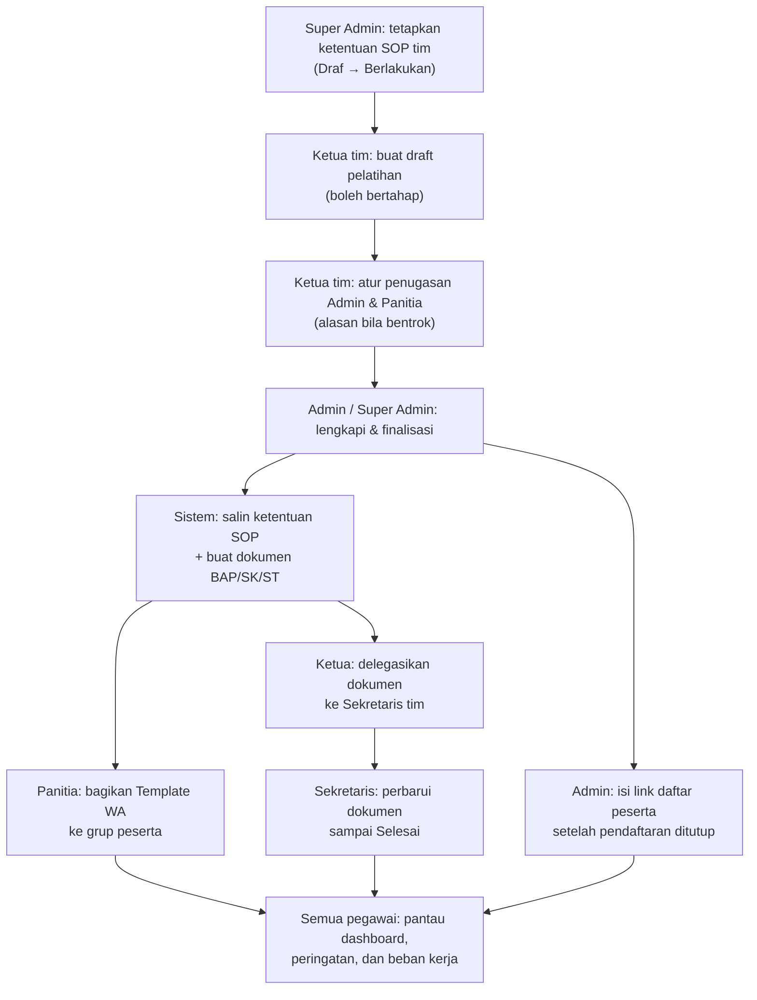
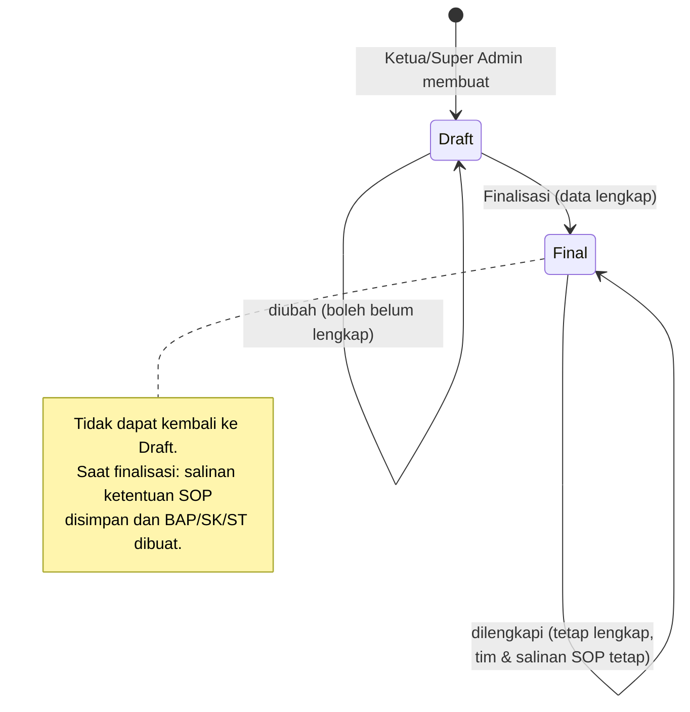
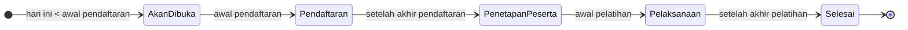
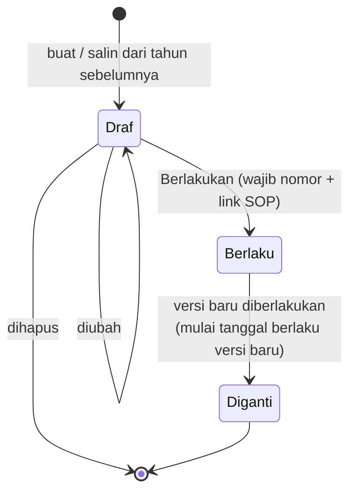
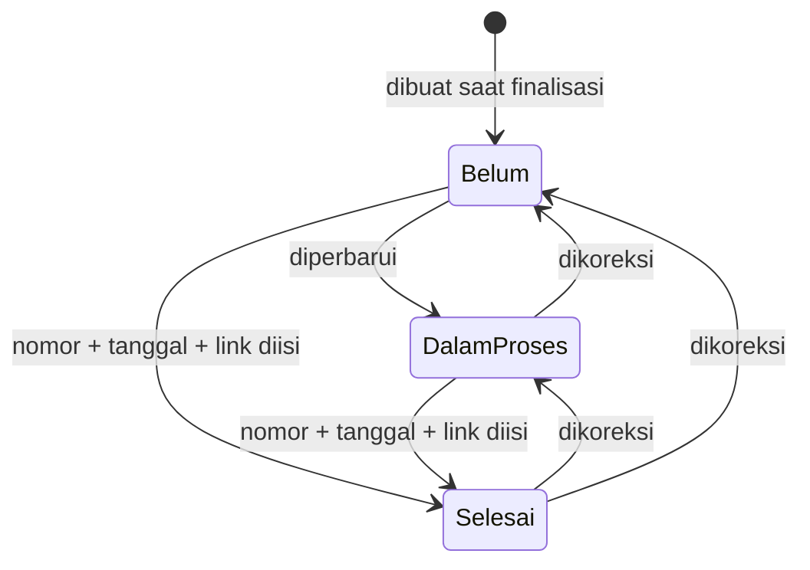
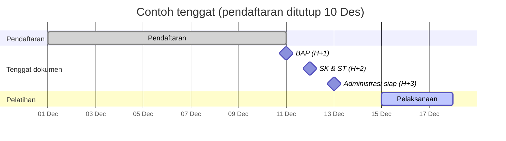
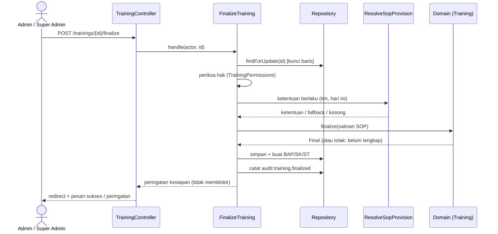
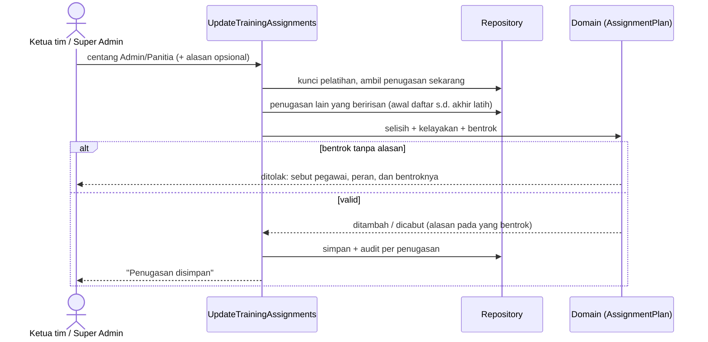

# Alur proses dan diagram status

Diagram di bawah menggambarkan perilaku SIMAPEL 0.1.0. Aturan rincinya ada di Domain dan ADR terkait.

## 1. Alur proses MVP-1 (gambaran besar)

## 2. Status pelatihan

### Status administrasi (disimpan)

### Status waktu (dihitung dari tanggal, tidak disimpan)

Pelatihan yang keempat tanggalnya belum lengkap tampil "Jadwal belum lengkap".

## 3. Status ketentuan SOP (ADR 0010)

Resolver memilih ketentuan untuk (tim, tanggal) sebagai berikut:
1. Versi Berlaku atau Diganti pada tahun yang sama dengan tanggal mulai berlaku ≤ tanggal tersebut; yang terakhir dipilih.
2. Bila tidak ada, dipakai versi terakhir tahun sebelumnya (fallback), disertai badge "Ketentuan 20XX belum ditetapkan".
3. Bila tetap tidak ada, hasilnya kosong dan badge "SOP belum dilampirkan" tampil.

## 4. Status dokumen administrasi

Delegasi (penanggung jawab) dapat diubah kapan saja oleh Ketua tim atau Super Admin, dan hanya kepada Sekretaris tim pelatihan.

## 5. Garis waktu tenggat dan peringatan (contoh ketentuan DTA)

Contoh: pendaftaran ditutup 10 Desember, pelatihan 15–17 Desember, ketentuan BAP H+1, SK/ST H+2, administrasi siap H+3.

| Tanggal | Peringatan (bila dokumen belum Selesai) |
|---|---|
| 11 Des, 00.00–23.59 WIB | "BAP tenggat hari ini"; "Link peserta kosong" bila link belum diisi |
| 12 Des | "BAP lewat tenggat", "SK/ST tenggat hari ini" |
| 13 Des | BAP, SK, ST lewat tenggat (belum kritis) |
| 14 Des dan seterusnya | "Administrasi kritis" (lewat tenggat administrasi siap) |
| 15–17 Des | "Segera berakhir" (sedang berlangsung, sisa ≤ ambang hari) |

## 6. Finalisasi pelatihan (sequence)

## 7. Penugasan dengan bentrok (sequence)

