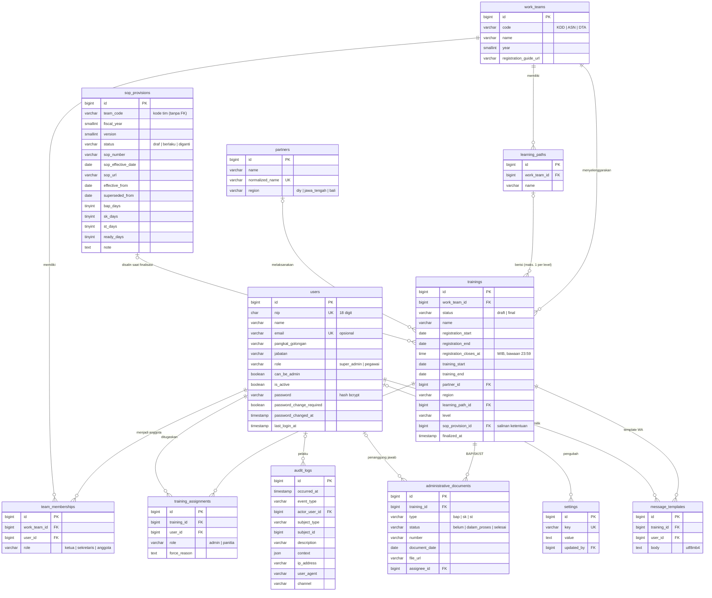

# Model data (ERD dan kamus data)

Dokumen ini menggambarkan struktur database SIMAPEL versi 0.1.0 (MySQL 8.4 LTS, `utf8mb4`), sesuai migrasi di `database/migrations`. Aturan bisnis tidak berada di database, melainkan di lapisan Domain (lihat [arsitektur.md](../arsitektur.md)). Database menegakkan integritas dasar: kunci asing, nilai unik, dan nilai bawaan.

Diagram memakai [Mermaid](https://mermaid.js.org/) dan dirender langsung oleh GitHub.

## ERD

Kolom audit `created_at`/`updated_at` (dan `created_by`/`updated_by` pada tabel yang memilikinya) tidak digambar agar diagram tetap ringkas; rinciannya ada di kamus data.

Catatan relasi:
- `sop_provisions.team_code` merujuk kode tim (`work_teams.code`) **tanpa kunci asing**, karena ketentuan berlaku per tim per tahun anggaran dan dapat dipakai lintas tahun sebagai fallback (ADR 0010).
- `trainings` menyimpan **salinan** ketentuan SOP (kolom `sop_*`) saat finalisasi. `sop_provision_id` hanya rujukan asal dan mengunci ketentuan tersebut dari penghapusan.
- Setiap pelatihan Final memiliki tepat tiga baris `administrative_documents` (BAP, SK, ST).
- `audit_logs.subject_type` + `subject_id` merujuk subjek peristiwa secara polimorfik (mis. `training`, `partner`), tanpa kunci asing, agar jejak audit tetap ada walaupun subjeknya berubah.

## Kamus data

Konvensi: **PK** kunci utama, **FK** kunci asing, **UK** unik, **N** boleh kosong (NULL). Semua tabel domain memiliki `created_at` dan `updated_at`.

### users: akun dan profil pegawai

| Kolom | Tipe | Keterangan |
|---|---|---|
| id | bigint PK | |
| nip | char(18) UK | NIP 18 digit; ditampilkan tersamar (`Nip::masked()`) |
| name | varchar(255) | Nama pegawai |
| email | varchar(255) UK, N | Opsional; tidak dipakai untuk login |
| pangkat_golongan | varchar(100) N | Sesuai template daftar pegawai |
| jabatan | varchar(150) N | |
| role | varchar(40), indeks | Peran global: `super_admin`, `pegawai` (ADR 0008) |
| can_be_admin | boolean, bawaan false | Dapat ditugaskan sebagai Admin pelatihan dan mengelola mitra |
| is_active | boolean, bawaan true, indeks | Akun nonaktif tidak dapat masuk; sesinya dicabut |
| password | varchar(255) | Hash bcrypt (12 putaran); tidak pernah ditampilkan |
| password_change_required | boolean | Wajib ganti kata sandi saat login berikutnya |
| password_changed_at, last_login_at | timestamp N | |
| remember_token | varchar(100) N | Tidak dipakai (fitur *remember me* dimatikan) |

### work_teams: tim kerja per tahun

| Kolom | Tipe | Keterangan |
|---|---|---|
| id | bigint PK | |
| code | varchar(10) | `KDD`, `ASN`, `DTA`; UK bersama `year` |
| name | varchar(150) | Keterampilan Digital Dasar, ASN Digital, Talenta Digital |
| year | smallint, indeks | Tahun tim |
| registration_guide_url | varchar(2048) N | Link panduan pendaftaran pelatihan tim (http/https) |

### team_memberships: anggota tim

| Kolom | Tipe | Keterangan |
|---|---|---|
| id | bigint PK | |
| work_team_id | FK → work_teams (restrict) | UK bersama `user_id` |
| user_id | FK → users (restrict), indeks | |
| role | varchar(20) | `ketua`, `sekretaris`, `anggota`. Ketua dan Sekretaris masing-masing maksimal satu per tim (Domain `TeamComposition`) |

### settings: pengaturan umum

| Kolom | Tipe | Keterangan |
|---|---|---|
| id | bigint PK | |
| key | varchar(64) UK | `digitalent_login_url`, `digitalent_register_url`, `dts_registration_guide_url`, `closing_soon_days` |
| value | text N | Kosong berarti memakai nilai bawaan (`closing_soon_days` = 7) |
| updated_by | FK → users (null on delete) N | |

### sop_provisions: ketentuan SOP berversi (ADR 0010)

| Kolom | Tipe | Keterangan |
|---|---|---|
| id | bigint PK | |
| team_code | varchar(10) | Kode tim; UK bersama `fiscal_year` dan `version` |
| fiscal_year | smallint | Tahun anggaran (tahun kalender) |
| version | smallint | Nomor versi dalam tahun anggaran |
| status | varchar(16) | `draf`, `berlaku`, `diganti` |
| sop_number | varchar(100) N | Nomor SOP; wajib saat diberlakukan |
| sop_effective_date | date N | Tanggal efektif dokumen SOP |
| sop_url | varchar(2048) N | Link SOP; wajib saat diberlakukan |
| effective_from | date | Tanggal mulai berlaku di aplikasi |
| superseded_from | date N | Tanggal mulai diganti versi berikutnya |
| bap_days, sk_days, st_days, ready_days | tinyint unsigned | Tenggat H+n (0–60) setelah pendaftaran ditutup; `ready_days` ≥ tenggat dokumen |
| note | text N | Catatan, mis. "perlu konfirmasi" |
| created_by, updated_by | FK → users (null on delete) N | |

Indeks tambahan: (`team_code`, `status`, `effective_from`).

### partners: mitra (ADR 0011)

| Kolom | Tipe | Keterangan |
|---|---|---|
| id | bigint PK | |
| name | varchar(150) | Nama organisasi (tanpa kontak pribadi) |
| normalized_name | varchar(150) UK | Huruf kecil tanpa tanda baca; mencegah duplikat |
| region | varchar(20) | `diy`, `jawa_tengah`, `bali` (menentukan WIB/WITA) |
| created_by, updated_by | FK → users (null on delete) N | |

### learning_paths: rangkaian pelatihan berjenjang (ADR 0009)

| Kolom | Tipe | Keterangan |
|---|---|---|
| id | bigint PK | |
| work_team_id | FK → work_teams (restrict) | Path milik satu tim |
| name | varchar(150) | |
| created_by | FK → users (null on delete) N | |

### trainings: pelatihan (ADR 0009, 0010, 0011)

| Kolom | Tipe | Keterangan |
|---|---|---|
| id | bigint PK | |
| work_team_id | FK → work_teams (restrict) | Tim penyelenggara |
| status | varchar(16), indeks | `draft`, `final` |
| name | varchar(255) | Nama/tema (satu-satunya isian wajib saat Draft) |
| registration_url | varchar(2048) N | Link pendaftaran/pelatihan |
| registration_start, registration_end | date N | Periode pendaftaran (inklusif) |
| registration_closes_at | time, bawaan 23:59:00 | Jam penutupan pendaftaran dalam WIB |
| training_start, training_end | date N | Periode pelatihan (inklusif) |
| partner_location | varchar(255) N | Lokasi/alamat pelaksanaan |
| partner_id | FK → partners (restrict) N | Wajib saat Final bila pelaksanaan oleh mitra |
| participant_list_url | varchar(2048) N | Link daftar peserta; diisi setelah pendaftaran ditutup |
| method | varchar(16) N | `luring`, `daring`, `hybrid` |
| batch | int unsigned N | 1–100.000 |
| syllabus_url | varchar(2048) N | Link silabus |
| level | varchar(16) N | `dasar`, `menengah`, `mahir` |
| certification | varchar(16) N | `global`, `skkni`, `industri`, `tidak_ada` |
| coc_shows_score | boolean N | Certificate of Completion menampilkan nilai |
| execution | varchar(16) N | `swakelola`, `mitra` |
| participant_category | varchar(16) N | `umum`, `disabilitas` |
| zonation | varchar(20) N | `wilayah_kerja`, `nasional` |
| region | varchar(20) N | Wilayah kerja `diy`, `jawa_tengah`, `bali`; wajib saat Final |
| lesson_hours, participant_target, registration_quota | int unsigned N | JP, target peserta, kuota pendaftar (1–100.000) |
| learning_path_id | FK → learning_paths (restrict) N | UK bersama `level` |
| sop_provision_id | FK → sop_provisions (restrict) N | Rujukan ketentuan yang disalin |
| sop_fiscal_year, sop_version | smallint N | Salinan |
| sop_number, sop_url | varchar N | Salinan |
| sop_bap_days, sop_sk_days, sop_st_days, sop_ready_days | tinyint N | Salinan tenggat |
| sop_is_fallback | boolean N | Salinan berasal dari ketentuan tahun sebelumnya |
| finalized_at | timestamp N | |
| finalized_by, created_by, updated_by | FK → users (null on delete) N | |

Indeks tambahan: (`training_start`, `training_end`), (`registration_start`, `registration_end`).

### training_assignments: penugasan Admin/Panitia

| Kolom | Tipe | Keterangan |
|---|---|---|
| id | bigint PK | |
| training_id | FK → trainings (cascade) | UK bersama `user_id` dan `role` |
| user_id | FK → users (restrict) | Indeks (`user_id`, `role`) |
| role | varchar(16) | `admin` (hanya pegawai `can_be_admin`), `panitia` |
| force_reason | text N | Alasan bila penugasan beririsan dengan penugasan lain (maks. 500 karakter) |
| created_by | FK → users (null on delete) N | |

### administrative_documents: BAP/SK/ST

| Kolom | Tipe | Keterangan |
|---|---|---|
| id | bigint PK | |
| training_id | FK → trainings (cascade) | UK bersama `type` |
| type | varchar(8) | `bap`, `sk`, `st` |
| status | varchar(16), bawaan `belum` | `belum`, `dalam_proses`, `selesai` |
| number | varchar(100) N | Wajib saat Selesai |
| document_date | date N | Wajib saat Selesai |
| file_url | varchar(2048) N | Link berkas di penyimpanan kantor; wajib saat Selesai |
| assignee_id | FK → users (null on delete) N | Sekretaris tim yang didelegasikan; indeks (`assignee_id`, `status`) |
| updated_by | FK → users (null on delete) N | |

### message_templates: template WA kustom

| Kolom | Tipe | Keterangan |
|---|---|---|
| id | bigint PK | |
| training_id | FK → trainings (cascade) | Indeks (`training_id`, `user_id`) |
| user_id | FK → users (cascade) | Pemilik template; maksimal 3 per pelatihan (Domain `TemplateSet`) |
| body | text `utf8mb4_unicode_ci` | Teks dengan placeholder daftar putih; mendukung emoji |

Template default **tidak disimpan**; ia dibentuk dari data pelatihan setiap kali ditampilkan.

### audit_logs: jejak audit (append-only)

| Kolom | Tipe | Keterangan |
|---|---|---|
| id | bigint PK | |
| occurred_at | timestamp, indeks | Waktu peristiwa |
| event_type | varchar(64), indeks | Lihat [katalog peristiwa audit](spesifikasi-teknis.md#9-katalog-peristiwa-audit) |
| actor_user_id | FK → users (null on delete) N | Pelaku |
| subject_type, subject_id | varchar(64) N, bigint N | Subjek peristiwa; indeks gabungan |
| description | varchar(500) | Ringkasan berbahasa Indonesia, tanpa NIP |
| context | json N | Nilai skalar; kunci `password`, `token`, `secret`, `nip`, `nik` ditolak |
| ip_address, user_agent | varchar N | |
| channel | varchar(16), bawaan `web` | `web` atau `cli` |

Pembaruan dan penghapusan baris audit ditolak oleh model (`PersistenceTest`).

### Tabel kerangka Laravel

| Tabel | Kegunaan |
|---|---|
| sessions | Sesi login (driver `database`, terenkripsi); dipakai untuk mencabut sesi akun nonaktif |
| cache, cache_locks | Cache dan kunci atomik (`CACHE_STORE=database`), termasuk pembatasan percobaan login |
| jobs, job_batches, failed_jobs | Antrean (`QUEUE_CONNECTION=database`); belum dipakai fitur MVP-1 |
