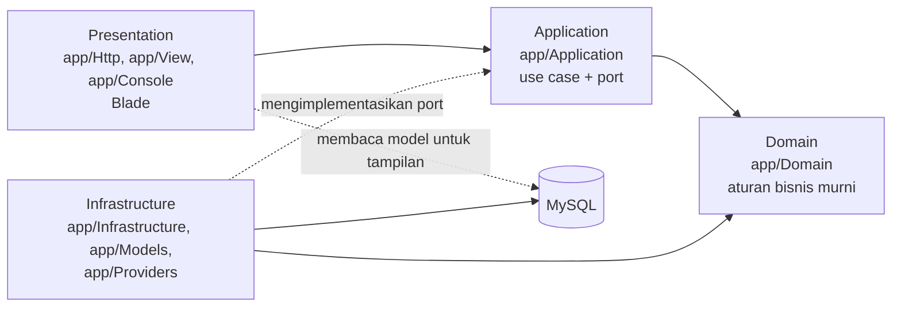

# Spesifikasi teknis SIMAPEL 0.1.0

Dokumen ini adalah rujukan teknis bagi pengembang dan pengelola sistem. Isinya mencerminkan versi 0.1.0 (tag `v0.1.0`). Dokumen pendamping:

| Topik | Dokumen |
|---|---|
| Struktur database | [model-data.md](model-data.md) |
| Aktor dan use case | [use-case.md](use-case.md) |
| Hak akses per peran | [hak-akses.md](hak-akses.md) |
| Status dan alur proses | [alur-dan-status.md](alur-dan-status.md) |
| Operasional (instalasi, backup, pembaruan) | [operasional.md](operasional.md) |
| Arsitektur berlapis | [../arsitektur.md](../arsitektur.md) |
| Keamanan dan PDP | [../keamanan.md](../keamanan.md), [../kepatuhan-pdp.md](../kepatuhan-pdp.md) |
| Pengujian dan CI/CD | [../pengujian.md](../pengujian.md), [../ci-cd.md](../ci-cd.md) |
| Keputusan arsitektur | [../adr/](../adr/) |

## 1. Ruang lingkup

SIMAPEL (Sistem Informasi Pengelolaan Pelatihan) adalah sistem pendukung administrasi dan pemantauan pelatihan regional BLSDM Komdigi Yogyakarta untuk wilayah kerja DIY, Jawa Tengah, dan Bali. SIMAPEL **tidak menggantikan** DTS/Digitalent pusat; pendaftaran peserta tetap berlangsung di Digitalent.

**Termasuk MVP-1:**
- akun dan keamanan;
- pegawai dan tim kerja;
- pengaturan dan ketentuan SOP berversi;
- pelatihan Draft → Final dan learning path;
- mitra dan wilayah kerja;
- penugasan Admin/Panitia;
- template WA;
- administrasi BAP/SK/ST;
- peringatan, dashboard, dan beban kerja.

**Di luar MVP-1** (ditunda, K10):
- MFA;
- assessment dan sertifikat (ADR 0007);
- SOP builder dan alur tahap SOP;
- integrasi otomatis Google Sheets/WhatsApp;
- notifikasi email;
- penyimpanan data peserta.

## 2. Teknologi

| Komponen | Versi | Catatan |
|---|---|---|
| PHP | 8.5 (FPM, Debian trixie) | `composer.json` mensyaratkan `^8.4` (ADR 0001) |
| Laravel | 13.40 | Blade untuk tampilan; tanpa framework/build frontend |
| MySQL | 8.4 LTS | `utf8mb4_unicode_ci` (ADR 0002) |
| nginx | 1.31 (alpine) | Reverse proxy ke PHP-FPM, menyajikan aset statis |
| CSS/JS | Statis di `public/` | `public/css/simapel.css` (tema gelap), `public/js/simapel.js` (ADR 0004) |
| PHPUnit | 13.4 | Unit, feature, dan uji arsitektur |
| Larastan / PHPStan | 3.14 / 2.3 (level 8) | Analisis statis |
| Laravel Pint | 1.32 | Gaya kode |
| Playwright | 1.65 (image `mcr.microsoft.com/playwright:v1.65.0-noble`) | Uji UI di Docker (ADR 0005) |

## 3. Arsitektur

Clean architecture pragmatis (ADR 0003, [arsitektur.md](../arsitektur.md)), ditegakkan otomatis oleh `tests/Architecture/LayerDependencyTest`:

| Modul | Domain (aturan) | Application (use case/query) |
|---|---|---|
| Identity | `Nip`, `Role`, `EmployeeProfile`, `PasswordPolicy` | buat akun, ubah pegawai, aktif/nonaktif, reset dan ganti kata sandi, impor CSV |
| Organization | `WorkTeamCode`, `TeamRole`, `TeamComposition` | atur anggota tim, link panduan tim |
| Settings | `GlobalSetting` | baca/ubah pengaturan umum |
| Sop | `SopProvision`, `SopProvisionHistory`, `SopProvisionResolver`, `AdministrativeDeadlines` | draf/ubah/hapus/berlakukan/salin ketentuan, resolve ketentuan per tanggal |
| Training | `Training`, `TrainingDetails`, `TrainingSchedule`, `LearningPath`, `TrainingPermissions`, `PreparationGap` | buat/ubah/finalisasi pelatihan, penempatan learning path, akses |
| Partner | `Partner`, `PartnerPermissions` | simpan mitra, resolve mitra/wilayah saat menyimpan pelatihan |
| Assignment | `TrainingAssignment`, `AssignmentPlan`, `WorkloadConflictDetector` | atur penugasan, query bentrok |
| Messaging | `Placeholder`, `TemplateRenderer`, `TemplateBody`, `TemplateSet`, `DefaultTemplate` | pratinjau, simpan, dan reset template WA |
| Administration | `AdministrativeDocument`, `DocumentPermissions`, `TrainingAlerts`, `DocumentDeadline` | delegasi/perbarui dokumen, query peringatan, dashboard |
| Workload | `PeriodGrouping`, `WorkloadMatrix`, `WorkloadRole` | matriks beban kerja, detail pegawai |
| Shared | `DateRange`, `HttpUrl`, `TimeOfDay`, `WorkRegion`, `RegistrationDeadline`, `BusinessRuleViolation` | port `Clock`, `Transaction`, `AuditTrail` |

Prinsip penting:
- **Semua perubahan data lewat use case.** Perubahan data dan jejak auditnya ditulis dalam satu transaksi. Baris yang diperebutkan dikunci (`lockForUpdate`), misalnya susunan tim, ketentuan SOP per tim, pelatihan saat penugasan/finalisasi, dan learning path.
- **Waktu dari port `Clock`**, dengan zona waktu aplikasi `Asia/Jakarta`. Status waktu dan peringatan dihitung, bukan disimpan.
- **Pelanggaran aturan bisnis** (`BusinessRuleViolation`) dipetakan menjadi pesan di field formulir. Penolakan hak akses dari use case menjadi 403.
- **Mode ketat Eloquent** aktif di luar production: *lazy loading* dan atribut tak terdaftar langsung gagal.

## 4. Lingkungan runtime

### Docker (pengembangan dan uji)

| Layanan | Image | Port host | Fungsi |
|---|---|---|---|
| app | `simapel-app:dev` (target `dev` dari `docker/php/Dockerfile`) | — | PHP-FPM + Composer |
| web | `nginx:1.31-alpine` | `127.0.0.1:${APP_PORT}` (bawaan 8080) | HTTP |
| db | `mysql:8.4` | `127.0.0.1:${FORWARD_DB_PORT}` (bawaan 3307) | Database `simapel` + `simapel_testing` |
| adminer | `adminer:6.3.0-standalone` (profil `tools`) | `127.0.0.1:${ADMINER_PORT}` (bawaan 8081) | Peramban database (lokal saja) |
| playwright | `mcr.microsoft.com/playwright:v1.65.0-noble` (profil `e2e`) | — | Uji UI |

### Image production

- Dibangun dari target `prod` di `docker/php/Dockerfile`: dependensi tanpa paket dev, berjalan sebagai pengguna `www-data`, dengan `HEALTHCHECK php-fpm -t`.
- Diterbitkan workflow `release-image.yml` ke `ghcr.io/i-sato/simapel` saat tag `v*.*.*` di-push (0.1.0: `ghcr.io/i-sato/simapel:0.1.0`, beserta SBOM dan provenance).
- Batas PHP: `memory_limit` 256M, `upload_max_filesize` 10M, `post_max_size` 12M; `expose_php` off. nginx: `server_tokens off`, `client_max_body_size` 12m.
- Endpoint kesehatan Laravel: `GET /up`.

## 5. Konfigurasi (variabel lingkungan)

| Variabel | Bawaan contoh | Keterangan |
|---|---|---|
| `APP_ENV` | `local` | `production` di server |
| `APP_DEBUG` | `true` | **Wajib `false` di production** |
| `APP_KEY` | dibuat `make setup` | Kunci enkripsi sesi; simpan aman, jangan diganti tanpa rencana |
| `APP_URL` | `http://localhost:8080` | URL publik |
| `APP_TIMEZONE` | `Asia/Jakarta` | Dasar perhitungan tanggal, tenggat, dan WIB |
| `APP_LOCALE` | `id` | Bahasa Indonesia |
| `DB_HOST`, `DB_DATABASE`, `DB_USERNAME`, `DB_PASSWORD` | `db`, `simapel`, `simapel`, acak | Kata sandi diisi acak oleh `make setup` |
| `SESSION_DRIVER` | `database` | Sesi di tabel `sessions` |
| `SESSION_LIFETIME` | 60 | Menit tanpa aktivitas |
| `SESSION_EXPIRE_ON_CLOSE` | `true` | Sesi berakhir saat peramban ditutup |
| `SESSION_ENCRYPT` | `true` | Isi sesi terenkripsi |
| `SESSION_SECURE_COOKIE` | `false` | **Wajib `true` di production (HTTPS)** |
| `SESSION_SAME_SITE` | `lax` | |
| `BCRYPT_ROUNDS` | 12 | Biaya hash kata sandi |
| `LOG_STACK`, `LOG_DAILY_DAYS`, `LOG_LEVEL` | `daily`, 30, `debug` | Production minimal `warning` |
| `CACHE_STORE`, `QUEUE_CONNECTION` | `database` | |
| `MAIL_MAILER` | `log` | Email belum dipakai (ditunda) |
| `TRUSTED_PROXIES` | kosong | IP reverse proxy tepercaya, dipisah koma |
| `SIMAPEL_LOGIN_MAX_ATTEMPTS`, `SIMAPEL_LOGIN_DECAY_SECONDS` | 5, 300 | Batas percobaan login per NIP+IP |
| `APP_PORT`, `FORWARD_DB_PORT`, `ADMINER_PORT`, `HOST_UID`, `HOST_GID` | 8080, 3307, 8081, 1000, 1000 | Docker lokal |
| `E2E_NIP` / `E2E_PASSWORD` | `999900000000000001` / acak per eksekusi | Hanya uji E2E (lokal/CI) |

Kebijakan kata sandi (`config/simapel.php`): minimal 12 karakter dan maksimal 72 byte (batas bcrypt), dengan huruf besar, huruf kecil, angka, dan simbol.

## 6. Ringkasan fungsi dan aturan

| Fungsi | Aturan utama | Rujukan |
|---|---|---|
| Login NIP | NIP 18 digit; pesan gagal seragam (tanpa enumerasi akun); `Auth::attempt` ber-*timebox*; batas 5/5 menit per NIP+IP dan 20/menit per IP; regenerasi sesi | keamanan.md |
| Pegawai | NIP unik; nonaktif mencabut sesi; minimal satu Super Admin aktif; impor CSV semua-atau-tidak (maks. 2 MB/1.000 baris) | ADR 0008 |
| Tim kerja | KDD/ASN/DTA per tahun; maksimal satu Ketua dan satu Sekretaris; satu pegawai boleh di beberapa tim | ADR 0008 |
| Ketentuan SOP | Draf → Berlaku → Diganti per tim per tahun anggaran; revisi tengah tahun = versi baru; resolver per tanggal dengan fallback ke tahun sebelumnya | ADR 0010 |
| Pelatihan | Draft parsial → Final lengkap; status waktu dihitung dari tanggal; link daftar peserta setelah pendaftaran ditutup; salinan ketentuan SOP saat finalisasi | ADR 0009 |
| Learning path | Satu level satu pelatihan per path; path satu tim | ADR 0009 |
| Mitra dan wilayah | Wilayah kerja menentukan WIB/WITA; jam penutupan per pelatihan (bawaan 23.59 WIB); nama mitra dinormalisasi | ADR 0011 |
| Penugasan | Admin hanya pegawai bertanda Admin; bentrok (awal pendaftaran sampai akhir pelatihan, inklusif) wajib disertai alasan | K4, K8, K15 |
| Template WA | Default dari data terkini; maks. 3 kustom; placeholder daftar putih; elemen wajib + "gratis" di 5 baris terakhir; tidak pernah dieksekusi | K16, keamanan.md |
| Administrasi | BAP/SK/ST dibuat saat finalisasi; delegasi ke Sekretaris; Selesai wajib nomor, tanggal, dan link | K3 |
| Peringatan | Tenggat = akhir pendaftaran + H+n (salinan); "tenggat hari ini" 00.00–23.59 WIB; kritis setelah administrasi siap/pelatihan dimulai; segera berakhir saat berlangsung (≤ N hari) | K17 |
| Beban kerja | Per pelatihan; Ketua tidak dinilai bentrok; Sekretaris bentrok dengan tugas Admin/Panitia lain | K19 |

Daftar lengkap keputusan pemilik proyek (K1–K19) ada di [mvp-1/panduan.md](../mvp-1/panduan.md).

## 7. Antarmuka HTTP

Semua halaman memakai Blade (server-rendered); tidak ada API publik. Seluruh route di luar `/login` mewajibkan login, akun aktif, dan kata sandi yang tidak wajib diganti. Formulir dilindungi token CSRF.

| Metode | Path | Nama route | Akses |
|---|---|---|---|
| GET/POST | `/login` | `login`, `login.store` | Tamu (POST dibatasi `throttle:login`) |
| POST | `/logout` | `logout` | Login |
| GET | `/dashboard` | `dashboard` | Semua |
| GET/PUT | `/account/password` | `account.password.*` | Semua |
| GET | `/trainings`, `/trainings/{training}` | `trainings.index`, `trainings.show` | Semua |
| GET/POST | `/trainings/create`, `/trainings` | `trainings.create`, `trainings.store` | gate `create-training` |
| GET/PUT | `/trainings/{training}/edit`, `/trainings/{training}` | `trainings.edit`, `trainings.update` | gate `update-training` |
| POST | `/trainings/{training}/finalize` | `trainings.finalize` | gate `finalize-training` |
| GET/PUT | `/trainings/{training}/assignments` | `trainings.assignments.*` | gate `manage-training-assignments` |
| GET/POST/PUT | `/trainings/{training}/messages`, `…/messages/{template}`, `…/messages/{template}/reset` | `trainings.messages.*` | gate `use-message-templates` + pemilik template |
| GET/PUT/POST | `/trainings/{training}/documents/{document}/edit`, `…/{document}`, `…/{document}/delegate` | `trainings.documents.*` | use case (Ketua/Super Admin/Sekretaris yang ditugaskan) |
| GET | `/workload`, `/workload/{employee}` | `workload.*` | Semua |
| GET | `/partners` | `partners.index` | Semua |
| POST/PUT | `/partners`, `/partners/{partner}` | `partners.store`, `partners.update` | gate `manage-partners` |
| GET | `/work-teams`, `/work-teams/{team}` | `work-teams.*` | Semua |
| POST/PUT/DELETE | `/work-teams/{team}/members…` | `work-teams.members.*` | gate `manage-organization` |
| GET/POST/PUT | `/employees…` (daftar, tambah, ubah, impor, aktif/nonaktif, reset kata sandi) | `employees.*` | gate `manage-organization` |
| GET/PUT/POST/DELETE | `/settings…`, `/settings/sop-provisions…` | `settings.*`, `sop-provisions.*` | gate `manage-organization` |
| GET | `/up` | — | Pemeriksaan kesehatan (tanpa login) |

Perintah CLI: `php artisan simapel:user:create` membuat akun. Kata sandi diminta secara tersembunyi, dan opsi `--role` bernilai `super_admin` atau `pegawai`.

## 8. Keamanan

Kontrol yang diterapkan dipetakan ke OWASP Top 10:2025 di [keamanan.md](../keamanan.md). Ringkasnya:

- **Header** pada semua respons:
  - CSP: `default-src 'self'; script-src 'self'; style-src 'self'; img-src 'self' data:; font-src 'self'; connect-src 'self'; form-action 'self'; frame-ancestors 'none'; base-uri 'self'; object-src 'none'`, ditambah `upgrade-insecure-requests` di HTTPS;
  - `X-Frame-Options: DENY`, `X-Content-Type-Options: nosniff`, `Referrer-Policy: same-origin`, `Permissions-Policy` (kamera, mikrofon, lokasi, pembayaran, USB dimatikan), COOP/CORP `same-origin`;
  - HSTS di HTTPS;
  - `Cache-Control: no-store, private` untuk halaman terautentikasi.
- **Tanpa style/script/handler inline:** perilaku halaman memakai atribut `data-*` (`data-confirm`, `data-copy-target`).
- **Validasi berlapis:** Form Request memeriksa bentuk input; Domain memeriksa aturan bisnis. Link hanya `http/https`; teks pengguna tidak pernah dikompilasi sebagai template.
- **Otorisasi:** gate pada route dan pemeriksaan ulang di use case. Id anak (dokumen, template) diperiksa terhadap induknya.
- **Data pribadi:** NIP tersamar di tampilan dan audit; inventaris di [kepatuhan-pdp.md](../kepatuhan-pdp.md).

## 9. Katalog peristiwa audit

Disimpan di `audit_logs` (append-only). Konteks hanya berisi nilai skalar; NIP, kata sandi, dan token ditolak.

| Kode | Arti |
|---|---|
| `auth.login_succeeded`, `auth.login_failed`, `auth.login_throttled` | Login berhasil, gagal, dibatasi |
| `auth.logged_out`, `auth.session_revoked` | Keluar; sesi dicabut karena akun nonaktif |
| `account.password_changed` | Kata sandi diganti |
| `user.created` | Akun dibuat (web atau CLI) |
| `employee.updated`, `employee.activated`, `employee.deactivated`, `employee.password_reset`, `employee.imported` | Pengelolaan pegawai |
| `team.member_assigned`, `team.member_role_changed`, `team.member_removed`, `team.guide_updated` | Tim kerja |
| `setting.updated` | Pengaturan umum (nilai lama/baru) |
| `sop_provision.drafted`, `.updated`, `.deleted`, `.activated`, `.superseded` | Ketentuan SOP |
| `training.drafted`, `training.updated`, `training.finalized`, `learning_path.created` | Pelatihan (perubahan per field, salinan SOP saat finalisasi) |
| `training_assignment.added`, `training_assignment.removed` | Penugasan, termasuk alasan force |
| `message_template.saved`, `message_template.reset` | Template WA (tanpa isi template) |
| `administrative_document.delegated`, `administrative_document.updated` | Dokumen BAP/SK/ST |
| `partner.created`, `partner.updated` | Mitra |

## 10. Kebutuhan non-fungsional

| Aspek | Ketentuan | Bukti |
|---|---|---|
| Kinerja | Halaman Beban Kerja memakai jumlah query tetap (≤ 12, termasuk sesi), diuji dengan 100 pegawai × 50 pelatihan; daftar pelatihan dipaginasi 20 per halaman | `WorkloadTest` |
| Zona waktu | Semua tanggal dihitung dalam `Asia/Jakarta`; tampilan Bali dikonversi ke WITA | `RegistrationDeadlineTest` |
| Tampilan ponsel | Lebar 390 px tanpa gulir horizontal halaman; tabel bergulir di wadahnya | `layout.spec.ts`, `beban-kerja.spec.ts` |
| Aksesibilitas | Tautan lewati konten, label formulir, `role="status"` untuk pesan, teks `sr-only` pada badge | `layout.spec.ts` |
| Peramban | Dirancang untuk peramban modern tanpa dukungan khusus peramban lama; uji otomatis memakai Chromium | Playwright |
| Bahasa | Antarmuka dan pesan dalam bahasa Indonesia | — |
| Data uji | Selalu sintetis (NIP diawali 9999) | ADR 0006 |

## 11. Mutu dan pengujian

| Pemeriksaan | Ketentuan (0.1.0) |
|---|---|
| PHPUnit (unit, arsitektur, feature) di MySQL `simapel_testing` | 418 tes lulus |
| Coverage baris | ≥ 80% wajib (0.1.0: 98,67%) |
| Larastan level 8, Pint | Bersih |
| Playwright di Docker, area terdampak (`e2e/impact-map.json`) | 41 uji (1 bersyarat dilewati) |
| Audit dependensi (`composer audit`, `npm audit`) | Tanpa kerentanan |
| Pemindaian rahasia (gitleaks) | Di CI |

Perintah: `make ci` (lint, stan, coverage, uji UI terdampak) dan `make e2e` (semua uji UI). Lihat [pengujian.md](../pengujian.md).

## 12. CI/CD dan rilis

- **CI** (`.github/workflows/ci.yml`, pada PR dan push ke `main`):
  - gaya kode, analisis statis, dan audit dependensi;
  - PHPUnit + coverage (MySQL 8.4);
  - UI Playwright untuk area terdampak (versi image dan paket diperiksa sama);
  - pemindaian rahasia;
  - build image production.
- **Rilis** (`.github/workflows/release-image.yml`, pada tag `v*.*.*`): membangun dan menerbitkan image ke GHCR beserta SBOM dan provenance.
- **Deploy belum diotomasi**, karena masih menunggu informasi server (lihat [ci-cd.md](../ci-cd.md) dan [operasional.md](operasional.md)).
- **Penomoran versi** mengikuti Semantic Versioning; catatan rilis ada di `CHANGELOG.md`.
