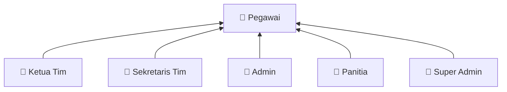
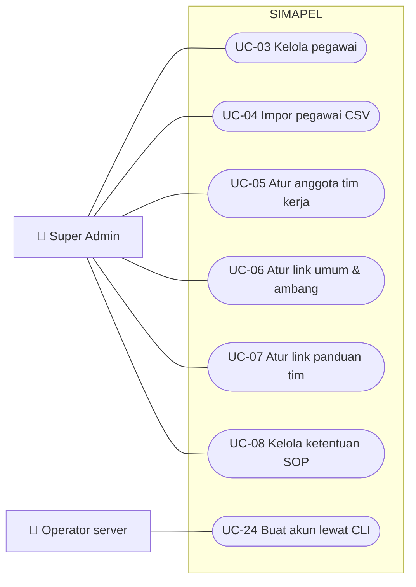
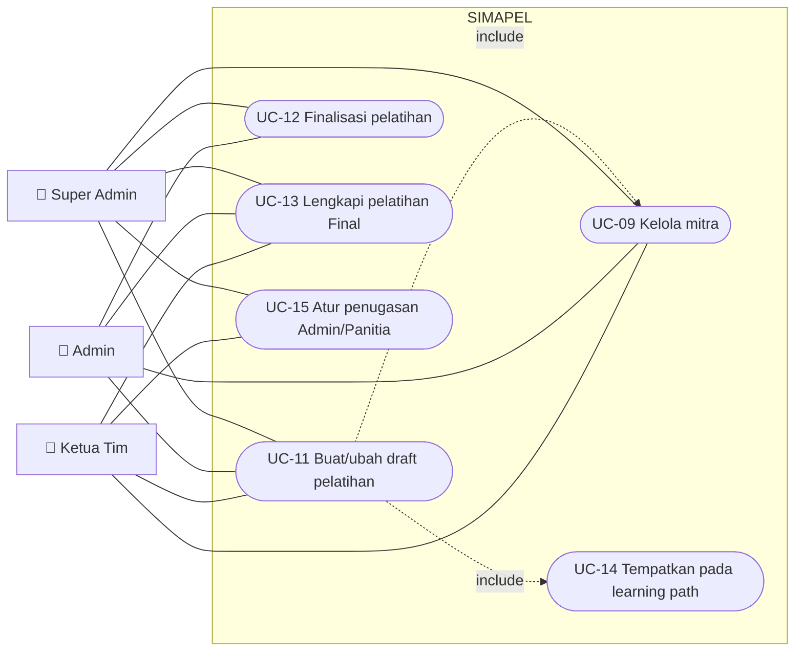
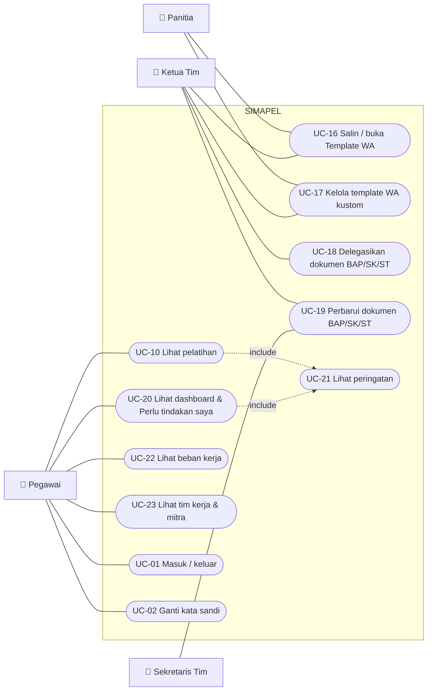

# Use case SIMAPEL (MVP-1)

Dokumen ini memetakan aktor dan use case SIMAPEL versi 0.1.0. Diagram memakai flowchart Mermaid sebagai pengganti diagram use case UML: aktor di luar kotak sistem, use case berbentuk elips. Hak akses rinci per aksi ada di [hak-akses.md](hak-akses.md).

## Aktor

| Aktor | Siapa | Sumber peran |
|---|---|---|
| Pegawai | Setiap pegawai aktif yang login | Peran global `pegawai` |
| Ketua Tim | Ketua tim kerja (KDD, ASN, DTA) pada tahun tersebut | `team_memberships.role = ketua` |
| Sekretaris Tim | Sekretaris tim kerja | `team_memberships.role = sekretaris` |
| Admin | Pegawai bertanda "dapat menjadi Admin". Disebut "Admin yang ditugaskan" bila ditugaskan pada pelatihan tertentu | `users.can_be_admin` + `training_assignments.role = admin` |
| Panitia | Pegawai yang ditugaskan sebagai panitia pada pelatihan tertentu | `training_assignments.role = panitia` |
| Super Admin | Pengelola sistem; dapat melakukan semua use case | Peran global `super_admin` |
| Operator server | Petugas teknis yang menjalankan perintah CLI | Akses server, bukan akun aplikasi |

Satu orang dapat memegang beberapa peran sekaligus, misalnya Sekretaris DTA yang juga Panitia pelatihan KDD (ADR 0008).

*Panah berarti "adalah juga": setiap aktor juga dapat melakukan use case Pegawai.*

## Diagram 1: Administrasi sistem

## Diagram 2: Pelatihan, penugasan, dan mitra

Catatan:
- Admin hanya pada pelatihan yang ia admin-i untuk UC-11, UC-12, dan UC-13. Untuk UC-09, semua pegawai bertanda Admin dapat menambah mitra.
- Ketua hanya pada pelatihan tim yang ia pimpin.

## Diagram 3: Pelaksanaan dan pemantauan

Catatan:
- Admin yang ditugaskan dan Super Admin juga dapat melakukan UC-16 dan UC-17.
- Super Admin juga dapat melakukan UC-18 dan UC-19.
- Peringatan (UC-21) dihitung sistem dari tanggal hari ini dan salinan ketentuan SOP pada pelatihan.

## Katalog use case

| ID | Use case | Aktor | Prasyarat | Alur utama | Aturan dan hasil |
|---|---|---|---|---|---|
| UC-01 | Masuk / keluar | Semua | Akun aktif | Isi NIP + kata sandi, lalu Dashboard; tombol Keluar | Pesan gagal seragam; maks. 5 percobaan/5 menit per NIP+IP dan 20/menit per IP; akun nonaktif ditolak; audit login |
| UC-02 | Ganti kata sandi | Semua | Login | Keamanan Akun, lalu isi kata sandi lama dan baru | Min. 12 karakter, huruf besar/kecil, angka, simbol; sesi lain diakhiri; wajib saat login pertama |
| UC-03 | Kelola pegawai | Super Admin | — | Pegawai: tambah, ubah, aktif/nonaktif, reset kata sandi | NIP 18 digit unik; nonaktif mengakhiri sesi; minimal satu Super Admin aktif |
| UC-04 | Impor pegawai CSV | Super Admin | Berkas template | Unggah CSV, divalidasi seluruhnya, lalu disimpan | Semua-atau-tidak; maks. 2 MB/1.000 baris; berkas tidak disimpan |
| UC-05 | Atur anggota tim kerja | Super Admin | Tim tahun berjalan | Tim Kerja: tambah/ubah peran/keluarkan anggota | Maks. satu Ketua dan satu Sekretaris per tim |
| UC-06 | Atur link umum & ambang | Super Admin | — | Pengaturan: link Digitalent, panduan DTS, ambang "segera berakhir" | Link http/https; ambang 1–60 hari (bawaan 7) |
| UC-07 | Atur link panduan tim | Super Admin | — | Pengaturan: link panduan pendaftaran per tim | Tampil di halaman tim dan Template WA |
| UC-08 | Kelola ketentuan SOP | Super Admin | — | Buat draf, ubah, berlakukan, salin dari tahun sebelumnya | Draf → Berlaku → Diganti; pemberlakuan wajib nomor + link SOP; ketentuan yang dirujuk pelatihan terkunci (ADR 0010) |
| UC-09 | Kelola mitra | Super Admin, Ketua, pegawai bertanda Admin | — | Mitra: tambah/ubah nama dan wilayah kerja | Nama dinormalisasi; duplikat ditolak (ADR 0011) |
| UC-10 | Lihat pelatihan | Semua | — | Daftar (filter tim/status/periode), lalu detail | Semua pegawai dapat melihat (K9) |
| UC-11 | Buat/ubah draft pelatihan | Ketua (timnya), Super Admin; Admin yang ditugaskan (ubah) | — | Form per bagian; mitra dengan autocomplete; wilayah kerja; jam penutupan | Draft boleh parsial; tanggal konsisten; link daftar peserta setelah pendaftaran ditutup |
| UC-12 | Finalisasi pelatihan | Super Admin, Admin yang ditugaskan | Draft lengkap | Tombol Finalisasi + konfirmasi | Menyalin ketentuan SOP yang berlaku; membuat dokumen BAP/SK/ST; tidak dapat kembali ke Draft |
| UC-13 | Lengkapi pelatihan Final | Super Admin, Ketua (timnya), Admin yang ditugaskan | Pelatihan Final | Lengkapi, lalu simpan | Data tetap lengkap; tim dan salinan SOP tidak berubah (K13) |
| UC-14 | Tempatkan pada learning path | Seperti UC-11 | — | Pilih path atau isi nama path baru di form | Satu level satu pelatihan per path; path satu tim |
| UC-15 | Atur penugasan | Ketua (timnya), Super Admin | — | Centang Admin/Panitia; isi alasan bila bentrok | Admin hanya pegawai bertanda Admin; bentrok tanpa alasan ditolak; audit (K4, K8, K15) |
| UC-16 | Salin / buka Template WA | Panitia, Ketua, Admin yang ditugaskan, Super Admin | Ditugaskan pada pelatihan | Pilih template, lalu Salin atau Buka di WhatsApp | Info kosong tampil "(menyusul)"; jam penutupan sesuai WIB/WITA |
| UC-17 | Kelola template WA kustom | Seperti UC-16 | — | Buat/ubah/reset template | Maks. 3; placeholder daftar putih; elemen wajib + "gratis" di akhir; tidak pernah dieksekusi (K16) |
| UC-18 | Delegasikan dokumen | Ketua (timnya), Super Admin | Pelatihan Final | Kartu Administrasi: pilih Sekretaris, lalu Delegasikan | Hanya ke Sekretaris tim pelatihan |
| UC-19 | Perbarui dokumen | Sekretaris yang ditugaskan, Ketua, Super Admin | Dokumen ada | Perbarui status/nomor/tanggal/link | Selesai wajib nomor + tanggal + link; tanpa unggah berkas |
| UC-20 | Dashboard & Perlu tindakan saya | Semua | — | Dashboard | Kartu ringkasan; dokumen yang didelegasikan; pelatihan yang saya admin-i tanpa link peserta |
| UC-21 | Lihat peringatan | Semua (dihitung sistem) | — | Badge di daftar, detail, dashboard | Tenggat hari ini/lewat, kritis, tenggat belum ditetapkan, link peserta kosong, segera berakhir, bentrok (K17) |
| UC-22 | Lihat beban kerja | Semua | — | Beban Kerja: matriks minggu/bulan, lalu detail pegawai | Ketua tidak dinilai bentrok; Sekretaris bentrok dengan tugas Admin/Panitia lain (K19) |
| UC-23 | Lihat tim kerja & mitra | Semua | — | Menu Tim Kerja dan Mitra | Tanpa NIP; hanya baca |
| UC-24 | Buat akun lewat CLI | Operator server | Akses container | `php artisan simapel:user:create` | Akun pertama dibuat tanpa kredensial bawaan; audit kanal `cli` |
